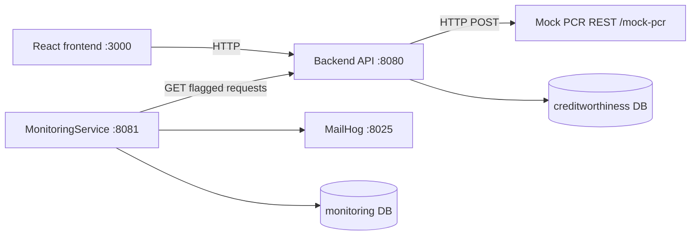

# Creditworthiness Checker (PCR PoC)

## What this is

In Finland, credit institutions must assess a consumer's creditworthiness on a fair, common and transparent basis, to prevent households from taking on too much debt. The Positive Credit Register (PCR), run by the Incomes Register Unit of the Finnish Tax Administration, holds the credit information used for that assessment.

This proof-of-concept is the tooling a credit institution's staff would use when a consumer applies for financing:

1. **Fetch** a credit extract for the consumer from the PCR and store it.
2. **Review** every previous fetch for that consumer (history), and open any single extract in full detail.
3. **Monitor** financing requests for consumers who have activated the _voluntary credit ban_, and report them by email on a schedule. The report goes to an internal monitoring mailbox (`pcr_monitoring@dansketest.dk`); consumers are not notified.

Every fetch is stored, which gives an audit trail of what the register returned at the time of each decision, and something to show if the PCR is temporarily unavailable.

API reference: [Requesting a credit register extract, API description v2.1](https://www.vero.fi/globalassets/pore/dokumentaatio-2026/requesting-a-credit-register-extract---api-description_2.1.pdf) (Finnish Tax Administration, April 2026)

## Quick start

**Prerequisites:** Docker Desktop (or Docker Engine + Compose v2).

```bash
docker compose up --build
```

| Service                      | URL                                                                 |
| ---------------------------- | ------------------------------------------------------------------- |
| UI                           | http://localhost:3000                                               |
| Backend API / Swagger        | http://localhost:8080 / http://localhost:8080/swagger-ui/index.html |
| MailHog inbox (sent reports) | http://localhost:8025                                               |
| MonitoringService            | http://localhost:8081 (no UI; logs + outbound mail)                 |

Stop with `docker compose down`. Reset DB volumes with `docker compose down -v`.

Mock consumers to try (not real Finnish SSNs):

| ID                      | Scenario                     |
| ----------------------- | ---------------------------- |
| `TEST-001`              | Typical extract              |
| `TEST-002` / `TEST-004` | Voluntary credit ban present |
| `TEST-003`              | Another sample extract       |

A financing request for `TEST-002` is flagged, and within about a minute the monitoring report shows up in MailHog.

### Running without Docker (for the apps)

Needs Java 17, Node.js 20+, PostgreSQL and an SMTP server on `:1025` (e.g. MailHog). Start infra with `docker compose up postgres mailhog -d`, then:

```bash
# copy config templates (once), for both backend services
cp backend/creditworthiness-checker/src/main/resources/application.properties.template \
   backend/creditworthiness-checker/src/main/resources/application.properties
cp backend/MonitoringService/src/main/resources/application.properties.template \
   backend/MonitoringService/src/main/resources/application.properties

# run each in its own terminal
cd backend/creditworthiness-checker && ./mvnw spring-boot:run
cd backend/MonitoringService && ./mvnw spring-boot:run
cd frontend && npm install && npm run dev   # http://localhost:5173
```

## Architecture

Three components, each with its own responsibility:



Both databases live on one PostgreSQL instance in Compose, but each service only touches its own.

| Component                                | Role                                                                                         |
| ---------------------------------------- | -------------------------------------------------------------------------------------------- |
| **Frontend**                             | Trigger PCR fetch by consumer ID, view history and extract detail, submit financing requests |
| **Backend** (`creditworthiness-checker`) | PCR integration (mocked), persistence, APIs for UI and monitoring                            |
| **MonitoringService**                    | Scheduled poll of flagged financing requests; email report to `pcr_monitoring@dansketest.dk` |

## Backend APIs (summary)

| Method | Path                            | Purpose                                                   |
| ------ | ------------------------------- | --------------------------------------------------------- |
| `POST` | `/fetch`                        | Fetch & store PCR extract                                 |
| `GET`  | `/fetch/{personIdCode}/history` | Fetch history                                             |
| `GET`  | `/fetch/{creditExtractId}`      | Extract detail                                            |
| `POST` | `/financing-requests`           | Register financing request (+ ban check)                  |
| `GET`  | `/financing-requests`           | List all financing requests                               |
| `GET`  | `/financing-requests/{id}`      | Financing request by ID                                   |
| `GET`  | `/financing-requests/flagged`   | Flagged requests for monitoring (optional `createdAfter`) |

## Assumptions

- **The PCR is mocked because the real API is not publicly accessible.** A small controller (`/mock-pcr/...`) in the backend project follows the PCR response structure from the API description. The backend calls it over a real HTTP POST through a client layer, so pointing it at the real PCR would mainly be a base-URL/config change plus real auth and certificates (not implemented).
- Only consumer (natural person) lookups are covered, as per the assignment. Not handled: company lookups, special handling of the deceased-person response, and change in parties to the loan.
- Per the API contract, the `voluntaryBanOnCredits` object is returned only when a voluntary credit ban is in effect, so the system treats **presence of the object as the ban signal**.
- Consumer identifiers are synthetic (`TEST-00x`), not real personal identity codes.
- Email goes to MailHog locally; production would use a real SMTP relay.

## Trade-offs

- **Mock PCR in the same project as the API**: simpler for a PoC; in production the register is an external system, accessed with real authentication and certificates.
- **No authentication or authorization**: all endpoints are open, which keeps the PoC easy to run and demo. Before handling real consumer data, the API (especially financing requests and the monitoring endpoint) would need to be secured with authentication and role-based access.
- **Separate MonitoringService + its own DB**: clear service boundary and independent deploy; adds ops cost vs an in-process scheduler.
- **Historical data is not trusted for ban checks**: a stale extract could miss a newly activated ban, so the check is marked `FAILED` and flagged instead.
- **Email-before-dedupe persistence**: favours "at least once" notification over "exactly once" if the process crashes after send but before save.
- **Plain-text email reports**: easy to inspect in MailHog; not a dashboard.

## Error handling

- Validation errors → `400`
- Missing extract or financing request → `404`
- PCR rejects the request or is unavailable → `502` / `503`. If the PCR is down and an earlier extract exists, the latest stored one is returned, marked `historical: true`.
- Financing request while the PCR is down (or only historical data is available) → saved with ban check status `FAILED` and flagged, not rejected, so an unverified request is never silently dropped.
- Monitoring: if the backend or SMTP is down, the failure is logged and the request is **not** marked as reported, so the next scheduled run retries.

## Tests

```bash
cd backend/creditworthiness-checker && ./mvnw verify
cd backend/MonitoringService && ./mvnw verify
```

Backend tests (20) focus on the service layer: credit fetch, history, detail and financing requests, including the PCR-failure paths. MonitoringService has a smaller set of tests. Not covered: the PCR HTTP client's error mapping, controller/exception-handler tests, and frontend tests.

## AI usage

Built with AI assistance, as the assignment allows. I designed the architecture, wrote the main backend logic (PCR integration, persistence, APIs) and debugged it by hand. I designed the frontend screens and flows, but the majority of the frontend code was AI-generated. The MonitoringService wiring, tests, Docker Compose setup and this README were drafted with AI prompts and then adjusted.

## Effort

~14 hours total

| Area                      |     |
| ------------------------- | --- |
| Domain reading, design    | 2 h |
| Main backend + mock PCR   | 6 h |
| Frontend                  | 3 h |
| MonitoringService + email | 1 h |
| Tests                     | 1 h |
| Docker Compose + docs     | 1 h |
